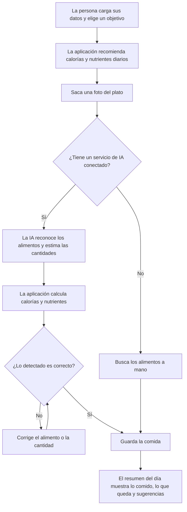

# Contrato de negocio — Qbit Nutrition

> **Aviso:** no hubo reuniones grabadas. Este contrato se armó con el pedido inicial y las respuestas del dueño en el chat del 2026-11-21, que no está guardado como archivo.
> Lo marcado "Acordada/Acordado" cita palabras del dueño o fue confirmado por él. Lo marcado "A confirmar" todavía no fue validado.

## 1. En dos minutos

**Problema que resolvemos:** Registrar lo que uno come a mano es tan lento que la gente abandona, y las aplicaciones que lo hacen con una foto son pagas, cerradas y se quedan con los datos.

**Qué va a notar quien la usa:**
- **Una foto y listo:** saca una foto del plato, revisa lo detectado y guarda la comida.
- **Objetivos a su medida:** la aplicación recomienda calorías y nutrientes según su peso, altura y demás datos personales.
- **Saber cómo viene el día:** ve cuánto comió, cuánto le queda y qué le conviene comer.
- **Elegir la IA:** conecta el servicio de inteligencia artificial que prefiera, desde la misma aplicación.
- **Diseño cuidado:** una aplicación moderna, con animaciones y transiciones, y con la identidad de la marca qbitdev.
- **Datos propios, gratis y abierta:** todo queda en su teléfono, el código es público y nadie cobra por usarla.

**Fuera de alcance de la primera versión:**
- Cobrar, suscripciones o publicidad — es un proyecto personal y de código abierto.
- Cuentas de usuario y copia en la nube — los datos quedan en el teléfono.
- Versión para iPhone y conexión con Apple Health — primero Android.
- Google Fit — descartado: deja de tener soporte a fines de 2026.
- Publicar en tiendas de aplicaciones — tienen costo.

**Preguntas abiertas:**
- Ninguna.

## 2. Cómo funciona

## 3. Reglas del negocio

| ID | Regla | Estado | Fuente |
|---|---|---|---|
| RN-01 | El proyecto no usa ningún servicio pago: construir, probar y distribuir la aplicación no le cuesta dinero a su dueño. | Acordada | chat con el dueño · 2026-11-21 · «Agnóstico con tier gratuito primero» |
| RN-02 | Cada persona usa el servicio y el modelo de IA que elija, con su propia cuenta, y lo configura dentro de la aplicación. No hay un servicio fijo. | Acordada | chat con el dueño · 2026-11-21 · «soportado para cualquier proveedor y modelo» |
| RN-03 | Los datos de la persona quedan en su teléfono. El proyecto no tiene servidor ni cuentas de usuario. | Acordada | chat con el dueño · 2026-11-21 · «Local-first sin backend» |
| RN-04 | Del teléfono solo sale lo que la persona decide enviar: la foto hacia el servicio de IA que eligió y los archivos que exporta. Antes del primer envío se le avisa a dónde va. | Acordada | chat con el dueño · 2026-11-21 · «04 ok» |
| RN-05 | La IA reconoce los alimentos y estima las cantidades; los valores nutricionales salen de una base de alimentos. Cuando un alimento no está en la base, su valor se muestra marcado como estimación de la IA. | Acordada | chat con el dueño · 2026-11-21 · «05 ok» |
| RN-06 | Antes de guardar una comida registrada con foto, la persona puede corregir cualquier alimento o cantidad que la IA haya detectado mal. | Acordada | chat con el dueño · 2026-11-21 · «corrige si la IA falló en algún ingrediente» |
| RN-07 | La aplicación aclara que no sustituye a un médico ni a un nutricionista. | Acordada | chat con el dueño · 2026-11-21 · «no sustituye a un nutricionista/médico profesional» |
| RN-08 | No se proponen objetivos a menores de 18 años, ni durante el embarazo o la lactancia, ni por debajo de un mínimo diario de calorías. La persona puede ajustar ese mínimo desde la configuración. | Acordada | chat con el dueño · 2026-11-21 · «podria configurarse o ajustarse desde las configuraciones» |
| RN-09 | Sin un servicio de IA conectado, la aplicación sigue sirviendo: se registra a mano y se consultan objetivos e historial. | Acordada | chat con el dueño · 2026-11-21 · «09 y 010 ok» |
| RN-10 | La aplicación está completa en español y en inglés. | Acordada | chat con el dueño · 2026-11-21 · «Global bilingüe (ES + EN)» |
| RN-11 | La primera versión es solo para Android. | Acordada | chat con el dueño · 2026-11-21 · «Android primero, iOS documentado» |
| RN-12 | La clave del servicio de IA nunca se incluye en lo que la persona exporta ni se muestra después de guardarla. | Acordada | chat con el dueño · 2026-11-21 · «12 ok» |
| RN-13 | Las calorías, proteínas, carbohidratos y demás nutrientes diarios se recomiendan a partir del peso, la altura y los demás datos de la persona que influyen: edad, sexo, nivel de actividad y objetivo. | Acordada | chat con el dueño · 2026-11-21 · «en base al peso, altura y todo lo que influya» |
| RN-14 | Valor inicial del mínimo diario de calorías, antes de que la persona lo ajuste: 1.200 para mujeres y 1.500 para hombres, según las Guías Alimentarias para Estadounidenses 2015–2020. | Acordada | chat con el dueño · 2026-11-22 · «lo apruebo» |
| RN-15 | El diseño es moderno, con animaciones, efectos, transiciones y botones redondeados, cuida la experiencia de uso y lleva la identidad de la marca personal qbitdev. | Acordada | chat con el dueño · 2026-11-21 · «moderno con animaciones, efectos, transiciones, botones redondeados» |
| RN-16 | Las tablas de alimentos cuya licencia no permite redistribuirlas no se incluyen en la aplicación ni en su código: cada persona importa su propio archivo y esos datos quedan solo en su teléfono. | Acordada | chat con el dueño · 2026-11-22 · «me gusta la opción 1» |

## 4. Requisitos

| ID | Requisito | Estado | Cambio | Listo cuando | Reglas | Fuente |
|---|---|---|---|---|---|---|
| REQ-01 | Registrar una comida con una foto del plato | Acordado | Sin cambios | Con un servicio de IA conectado, la foto de un plato muestra los alimentos detectados con sus gramos y calorías, y al guardar se suman al día | RN-05, RN-06, RN-11 | chat con el dueño · 2026-11-21 · «escaneo de platos» |
| REQ-02 | Corregir lo que detectó la IA | Acordado | Sin cambios | Se puede cambiar una cantidad, reemplazar, quitar o agregar un alimento, y los totales cambian sin volver a analizar la foto | RN-06 | chat con el dueño · 2026-11-21 · «corrige si la IA falló en algún ingrediente» |
| REQ-03 | Calcular macronutrientes y micronutrientes de cada comida | Acordado | Sin cambios | Cada comida muestra calorías, proteínas, carbohidratos y grasas, y en su detalle fibra, azúcares, sodio, vitaminas y minerales | RN-05 | chat con el dueño · 2026-11-21 · «cálculo de macros/micros» |
| REQ-04 | Recibir objetivos diarios recomendados para perder grasa o ganar músculo | Acordado | Sin cambios | Con peso, altura, edad, sexo y nivel de actividad cargados, al elegir un objetivo la aplicación propone calorías, proteínas, carbohidratos y grasas diarios, que la persona puede modificar | RN-08, RN-13, RN-14 | chat con el dueño · 2026-11-21 · «en base al peso, altura y todo lo que influya» |
| REQ-05 | Ver el resumen del día | Acordado | Sin cambios | Una pantalla muestra lo consumido, lo que queda según el objetivo y las comidas del día | — | chat con el dueño · 2026-11-21 · «Dashboard diario» |
| REQ-06 | Consultar el historial de comidas | Acordado | Sin cambios | Se puede abrir cualquier día anterior y modificar o borrar sus comidas | RN-03 | chat con el dueño · 2026-11-21 · «registro histórico» |
| REQ-07 | Registrar el peso y ver su evolución | Acordado | Sin cambios | Se carga el peso de un día y un gráfico muestra cómo cambió en el tiempo | — | chat con el dueño · 2026-11-21 · «registro de peso/medidas» |
| REQ-08 | Recibir recomendaciones según lo que falta para el objetivo | Acordado | Sin cambios | El resumen del día muestra una sugerencia basada en lo consumido y el objetivo, por ejemplo cuánta proteína falta | — | chat con el dueño · 2026-11-21 · «motor de recomendaciones» |
| REQ-09 | Conectar un servicio de IA desde la aplicación | Acordado | Sin cambios | Se carga el servicio, la clave y el modelo, y una prueba indica si funciona o por qué no | RN-01, RN-02, RN-12 | chat con el dueño · 2026-11-21 · «todo debe configurarse desde la misma app» |
| REQ-10 | Registrar una comida a mano, buscando alimentos | Acordado | Sin cambios | Sin conexión a internet, se busca un alimento en español o en inglés, se indica la cantidad y se guarda | RN-09 | chat con el dueño · 2026-11-21 · «09 y 010 ok» |
| REQ-11 | Usar la aplicación en español o en inglés | Acordado | Sin cambios | Se cambia el idioma y no queda ningún texto sin traducir | RN-10 | chat con el dueño · 2026-11-21 · «Global bilingüe (ES + EN)» |
| REQ-12 | Avisos de salud y de privacidad | Acordado | Sin cambios | El aviso de salud se acepta en el primer uso, y ambos textos se pueden volver a leer desde la aplicación | RN-04, RN-07 | chat con el dueño · 2026-11-21 · «Disclaimer Médico» |
| REQ-13 | Llevarse y borrar los datos propios | Acordado | Sin cambios | Se exporta todo a un archivo, se recupera en una instalación nueva con los mismos totales, y se puede borrar todo | RN-03, RN-12 | chat con el dueño · 2026-11-21 · «13 ok» |
| REQ-14 | Medir la precisión del cálculo a partir de fotos | Acordado | Sin cambios | Hay un conjunto de comidas pesadas en balanza y un informe con el error de calorías de cada modelo probado; con el modelo recomendado, al menos 6 de cada 10 comidas tienen un error de calorías menor al 20 % | — | chat con el dueño · 2026-11-21 · «qué tan preciso es el cálculo de calorías» |
| REQ-15 | Registrar medidas corporales | Acordado | Sin cambios | Se cargan medidas como cintura y cadera en una fecha y se ve cómo cambiaron en el tiempo | — | chat con el dueño · 2026-11-21 · «me gustaria que ya se lo incluya» |
| REQ-16 | Conectar con la aplicación de salud del teléfono Android | Acordado | Sin cambios | Con el permiso de la persona, las comidas guardadas aparecen en la aplicación de salud del teléfono y el peso registrado allí aparece en Qbit Nutrition | RN-04, RN-11 | chat con el dueño · 2026-11-21 · «me gustaria que ya se lo incluya» |
| REQ-17 | Pedir sugerencias de comidas hechas con IA | Acordado | Sin cambios | La persona pide sugerencias y recibe alimentos que encajan con lo que le queda del día; para eso se envían solo los números del día, nunca fotos ni historial | RN-02, RN-04 | chat con el dueño · 2026-11-21 · «me gustaria que ya se lo incluya» |
| REQ-18 | Registrar un producto envasado con su código de barras | Acordado | Sin cambios | Al leer el código de barras de un producto conocido aparecen su nombre y sus valores nutricionales, y se puede guardar indicando la cantidad | RN-04, RN-05 | chat con el dueño · 2026-11-21 · «Sí, incluirlo» |
| REQ-19 | Importar una tabla de alimentos propia desde un archivo | Acordado | Nuevo | Con un archivo de una tabla de alimentos descargado por la persona, la aplicación carga sus alimentos en el teléfono, se los puede buscar y registrar como cualquier otro, y se los puede quitar todos juntos | RN-03, RN-16 | chat con el dueño · 2026-11-22 · «así yo las importo una vez que tenga la app instalada» |

## 5. Cambios

### v7 — 2026-11-22 — importar tablas de alimentos
- **Nuevo:** REQ-19 y RN-16. El dueño quiere tener completas las tablas de alimentos que no se pueden incluir en la aplicación por su licencia; las importa cada persona en su propio teléfono.

### v6 — 2026-11-22 — confirmación del diseño
- **Pregunta cerrada:** P-06, el dueño confirmó la propuesta de diseño "Orbit" («el orbit esta bien»).

### v5 — 2026-11-22 — decisiones del dueño
- **Confirmado por el dueño:** RN-14, el mínimo inicial de 1.200 calorías para mujeres y 1.500 para hombres pasa de "A confirmar" a "Acordada". Cierra P-02.
- **Pregunta cerrada:** P-04, la licencia MIT va a nombre de qbitdevz (Leandro M. Álvarez Skeiker).
- Sigue abierta P-06, la elección de la propuesta de diseño.

### v4 — 2026-11-21 — pedido de diseño del dueño
- **Regla nueva:** RN-15, diseño moderno con la identidad de qbitdev. Reemplaza la línea visual que había propuesto el equipo.
- **Regla modificada:** RN-14, antes "a definir", ahora el equipo propone 1.200 y 1.500 calorías con su fuente; sigue pendiente de aprobación (P-02).
- **Pregunta nueva:** P-06, elección de la propuesta de diseño.
- **Aprobado:** el dueño aprobó en el chat lo necesario para continuar («yo te doy la autorizacion y aprobacion de lo que sea necesario»). RN-14 sigue "A confirmar": un valor de salud no se da por aprobado sin que el dueño lo vea.

### v3 — 2026-11-21 — aprobación del dueño
- **Aprobado:** el dueño aprobó el contrato en el chat.
- **Nuevo:** REQ-18, código de barras; el dueño pidió incluirlo en la primera versión. Sale de "Fuera de alcance" y cierra P-05.
- **Sigue sin validar:** RN-14, el valor inicial del mínimo diario de calorías (P-02).

### v2 — 2026-11-21 — revisión de la versión 1 por el dueño
- **Confirmado por el dueño:** RN-04, RN-05, RN-09, RN-12, REQ-10 y REQ-13 pasan de "A confirmar" a "Acordada/Acordado".
- **Nuevo:** REQ-15, REQ-16 y REQ-17. El equipo proponía postergarlos y el dueño pidió incluirlos en la primera versión.
- **Regla nueva:** RN-13, los objetivos se recomiendan según peso, altura y demás datos de la persona.
- **Regla modificada:** RN-08, antes "un mínimo diario de calorías: a definir", ahora la persona puede ajustar ese mínimo desde la configuración. Su valor inicial queda en RN-14.
- **Modificado:** REQ-04 suma RN-13 y RN-14; REQ-14 suma el umbral de precisión que el dueño aceptó (respuesta a P-03).
- **Preguntas cerradas:** P-01, el dueño confirma lo que queda fuera de alcance, salvo lo que pidió incluir. P-03, aceptado. P-04, el nombre es "Qbit Nutrition" y la licencia MIT; queda abierto solo el titular.
- **Pregunta nueva:** P-05, no quedó claro si el código de barras entra con lo demás.

### v1 — 2026-11-21 — pedido inicial y respuestas del dueño
- Versión inicial: 12 reglas y 14 requisitos.

## 6. Fuentes

- Chat con el dueño del 2026-11-21 — pedido inicial, dos rondas de respuestas y la revisión de la versión 1. No está guardado como archivo.
- docs/ — documentación de producto redactada por el equipo a partir de ese chat. Tiene el detalle de cada requisito, pero no es palabra del dueño.
- Externo (no leído por el agente): ninguno declarado.

## 7. Para quien construye

- Este contrato define el alcance. No se construye nada de "Fuera de alcance" ni lo que esté "A confirmar" o "Descartado".
- Antes de construir un requisito, leé su detalle en docs/02-prd.md: acá está el resumen, allá el detalle.
- Cada "Listo cuando" y cada regla (RN) asociada al requisito se convierte en una verificación o prueba.
- Si la documentación contradice una regla o un "Listo cuando", frená y preguntá antes de seguir.
- Si el estado del contrato es `borrador`, pedí confirmación antes de construir.
- No edites este archivo al construir. Los cambios de alcance entran por BCDD.
